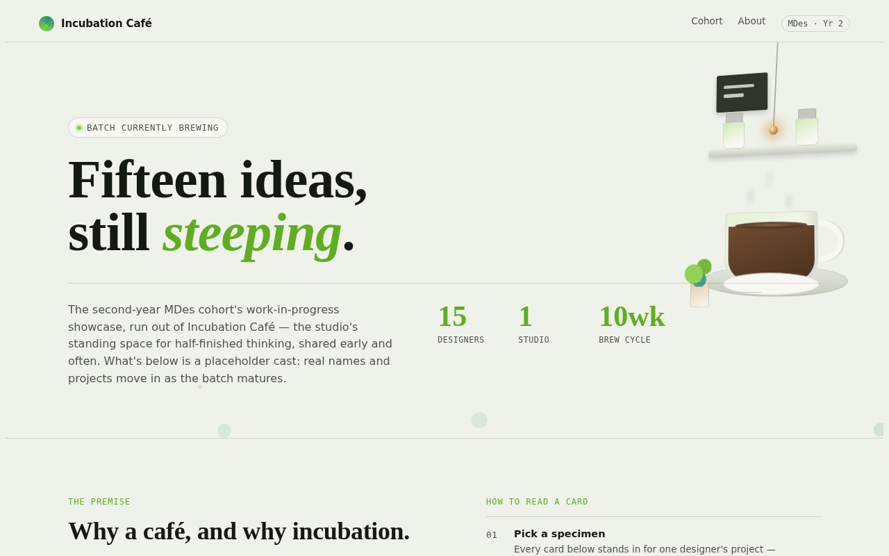
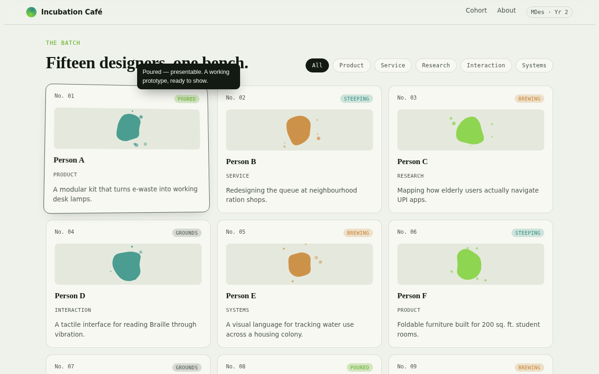
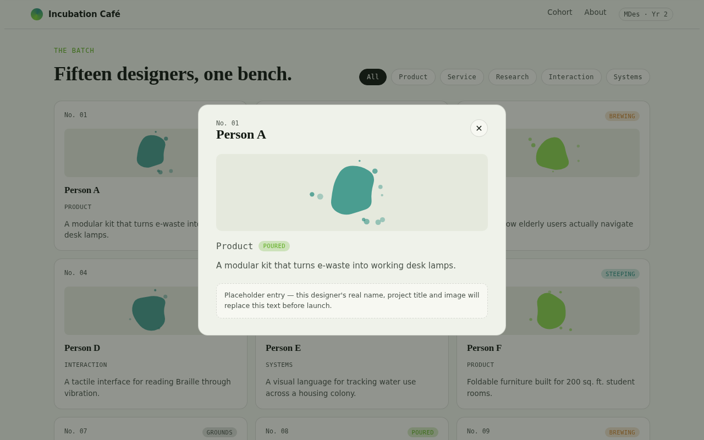
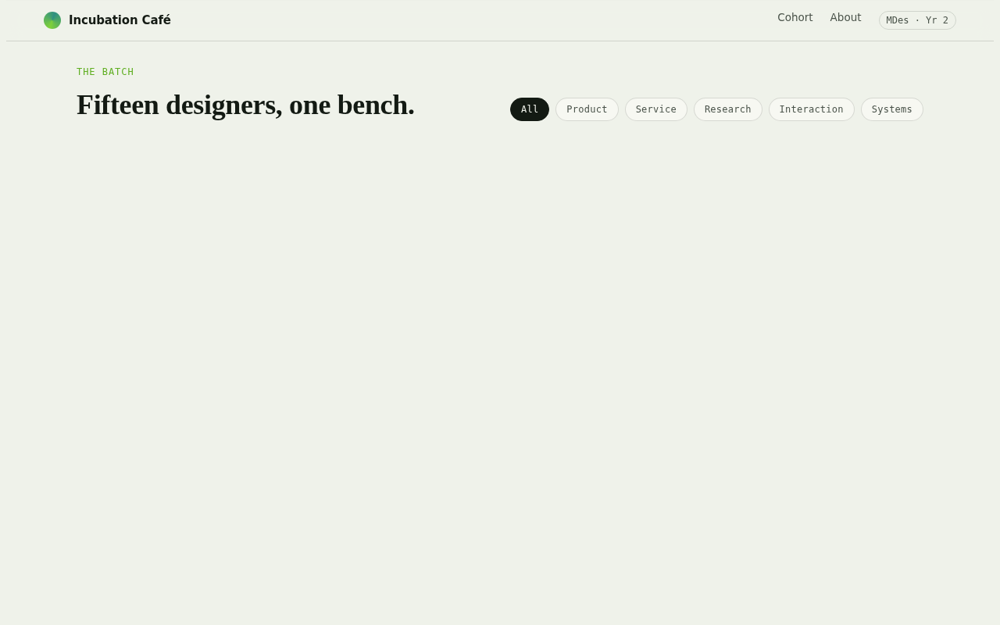
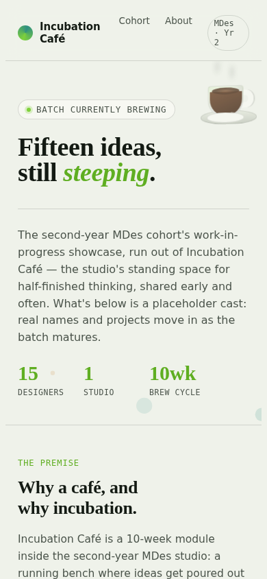
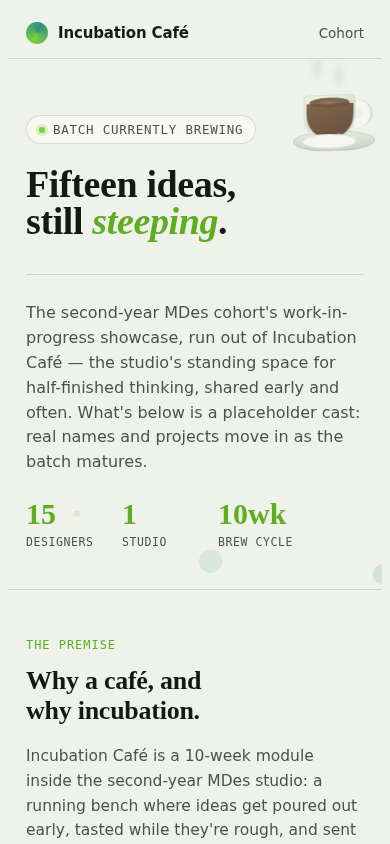

# Incubation Café: MDes Year 2 showcase (first iteration)

Open `index.html` in any browser (single file, no build step). `documentation.html` is the same write-up as a page with embedded photos.

## The idea
A showcase for 15 classmates' work from a 10-week MDes Year 2 module run under Incubation Café.
The site is framed as a café that is also an incubator: ideas are "brewed", not finished. A visitor
should understand the context within a few seconds, without being told what to click.
Names and projects are placeholders (Person A to O) until the real ones go in.

## What a visitor can do
- Land on the hero and read what this is: MDes Year 2, a 10-week module, 15 designers.
- Watch the 3D café corner (pendant lamp, shelf with jars, chalkboard, plant, cup filling with coffee)
  and move the cursor over it to tilt the whole scene.
- Browse 15 project cards. Each shows a project number, a brew stage, a discipline and a one-line pitch.
- Hover or tap a **brew stage** pill (Grounds, Brewing, Steeping, Poured) or a **discipline** pill
  (Product, Service, Research, Interaction, Systems) to get a small popup explaining it.
- Filter the grid by discipline.
- Open a card for a larger view of the project. Esc or a click outside closes it.
- Cards tilt in 3D under the cursor. Works with keyboard, on phones, and with reduced-motion settings.

## What I changed after trying it
Changes from your feedback while building:
1. Module length corrected from 12 to **10 weeks**.
2. I first added a separate glossary section for stages and disciplines. You asked for explanations to
   appear on hover instead, so I **removed the section and built hover/tap popups**.
3. "Make it a café experience" led to the 3D cup, then to the full 3D shop corner.

Changes from actually running the page in a browser (I had only syntax-checked it before):
1. **The 15 project cards disappeared** half a second after load (see `screenshots/1-before-cards-missing.png`).
   This was my bug, introduced when I added the 3D card tilt. A workaround to stop the entrance animation
   from blocking the tilt reset the cards to their hidden starting state. The cards now animate in from
   hidden and rest visible (`screenshots/3-after-cards-tooltip-tilt.png`).
| Before | After |
|---|---|
|  |  |

2. **The nav broke on phones**: the "MDes · Yr 2" pill wrapped onto three lines and the brand name
   wrapped (`5-before-mobile-nav.png`). The pill and secondary link are now hidden on small screens
   (`6-after-mobile-nav.png`).
| Before | After |
|---|---|
|  |  |

3. **The pendant lamp's wire started in mid-air.** It now hangs from the top edge of the hero.

## Known limits
- Fonts (Fraunces, IBM Plex) load from Google Fonts. My test browser could not reach them, so the
  screenshots show fallback fonts. The live page will look slightly different.
- Not tested in Safari or Firefox, only headless Chromium at 1280, 768 and 390 px wide.
- The "brew stage" and "discipline" assignments are invented placeholders.
- The cup scene is hidden down to a cup-only version on phones to keep the hero uncluttered.
